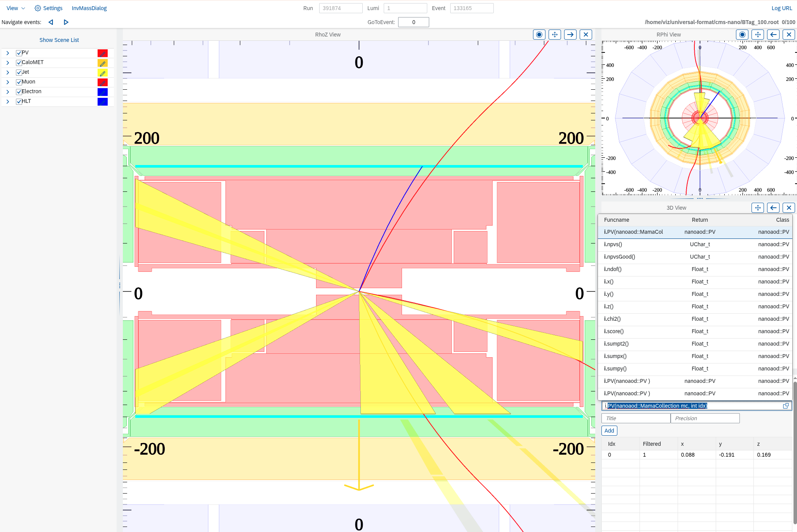

# cms-nano

Web-based event display for CMS NanoAOD files, built on ROOT's EVE 7 (REve).

cms-nano reads NanoAOD directly: it generates one C++ class per collection from the file's branches, so every branch can be used in tables and filter expressions. The event display itself (views, projections, navigation, tables, GUI) comes from [VSDNano](https://github.com/alja/VSDNano). cms-nano plugs into it as a data provider (`NanoProvider.h`) with its own proxy builders (`NanoProxyBuilders.h`).



## Requirements

- ROOT built from the `master` branch, with `root7`, `webgui` and `http` enabled (see below)
- A C++17 compiler (GCC or Clang)
- [nlohmann/json](https://github.com/nlohmann/json) headers (Fedora: `json-devel`, Debian/Ubuntu: `nlohmann-json3-dev`)
- A checkout of [VSDNano](https://github.com/alja/VSDNano) (see below)
- A web browser to view the display

## Building ROOT from master

EVE 7 changes often, so use a recent ROOT built from `master` rather than a release.

```bash
mkdir -p ~/root-dev/master && cd ~/root-dev/master
git clone --branch master https://github.com/root-project/root.git root

mkdir build && cd build
cmake -DCMAKE_BUILD_TYPE=Debug \
      -Dbuiltin_openui5=ON \
      -Dbuiltin_mathjax=ON \
      -Dbuiltin_civetweb=ON \
      -Dbuiltin_vdt=ON \
      -Dbuiltin_xrootd=ON \
      ../root
cmake --build . -j$(nproc)
```

`-Dbuiltin_openui5=ON` matters: without it, ROOT configures without the web GUI (it only warns) and EVE 7 can't open a display. `root7`, `webgui` and `http` are on by default. If CMake stops on a missing optional package (for example cfitsio), turn that feature off, e.g. `-Dfitsio=OFF`. Use `-DCMAKE_BUILD_TYPE=RelWithDebInfo` instead of `Debug` if you don't need to debug ROOT itself.

Check the build:

```bash
source ~/root-dev/master/build/bin/thisroot.sh
root-config --version
root-config --features | tr ' ' '\n' | grep -E '^(root7|webgui|http)$'
```

## Building cms-nano

```bash
source ~/root-dev/master/build/bin/thisroot.sh   # in every new shell

git clone https://github.com/alja/VSDNano.git ~/root-dev/VSDNano
git clone https://github.com/alja/cms-nano.git
cd cms-nano
make -j$(nproc) evd
```

The Makefile looks for VSDNano in `~/root-dev/VSDNano`. To use another location, pass it to every `make` call, e.g. `make evd VSDNANO=/path/to/VSDNano`. `make evd` builds VSDNano's libraries if they are missing; after changing VSDNano, rebuild it with `make` in its own directory.

A clean build takes about a minute with `-j`. Most of it is compiling the ROOT dictionaries: `EvdGui_dict.o`, the proxy builders, alone takes about 40 s.

The build has four steps:

1. `libCmsNanoAod.so`: generic NanoAOD reading code.
2. `gen-classes` reads the data file and the config, and generates `CmsNanoClasses.hxx/.cxx`, one class per collection, and the LinkDef for their proxy builders. Collections in the config that the data file does not have get no class; `gen-classes` says so.
3. `libNanoClassesEvd.so`: the generated classes and their proxy builders.
4. `evd`: `NanoProvider` plus VSDNano's event display, linked against VSDNano's `libVsdDict.so` and `libFWDict.so`.

The generated classes depend on the data file and the config. `make` records both in `.gen_config` and regenerates the classes when either changes, so switching needs no `make clean`:

```bash
make -j$(nproc) evd ROOTFILE=/path/to/other_nano.root CONFIG=my_config.json
```

One build can open files with other layouts. The generated accessors find their branches by name in each file that is opened: a member the file does not have reads as 0, and one stored with another type is converted. A collection that the file does not have, or that has no compiled-in class, is left out of the display. `evd` prints a line for each, e.g. `Collection Jet: 45 of 68 members not in this file (read as 0), 10 with a different type (converted).` To see a collection, such as `GenPart`, build with a data file that has it.

After upgrading ROOT, run `make clean` before rebuilding, and also `make clean` in VSDNano: its C++ modules must match the ROOT build.

## Running

```bash
make display
```

This builds what is out of date and runs:

```bash
./evd BTag_100.root --fconfig cmap.json
```

`evd` prints a URL, `http://localhost:9092/win1/`. Open it in a browser. If port 9092 is in use (for example by another `evd`), ROOT picks a different port and prints that one instead.

To use a different data file or config:

```bash
make display ROOTFILE=/path/to/nano.root CONFIG=my_config.json
```

### Running on a remote machine

Forward the port over SSH, then open the printed URL locally:

```bash
ssh -L 9092:localhost:9092 user@remote-host
```

## Event display service

`serviceVSDMama` starts event displays on request, one process per user session, for a web front end. It is VSDNano's `FWService` with `NanoProvider` as data provider.

```bash
make -j$(nproc) serviceVSDMama
./serviceVSDMama --port 5556
```

The default port is 5556. The service reads `.rootrc` from the directory it runs in; set the port range of the display web servers there, and HTTPS if the displays are reached through a proxy:

```
WebGui.HttpPortMin: 10000
WebGui.HttpPortMax: 10099
WebGui.UseHttps:    yes
WebGui.ServerCert:  /path/to/server.pem
```

A client sends one JSON request per connection, ending with a newline:

```bash
echo '{"action": "load", "file": "/path/to/nano.root", "config": "/path/to/cmap.json",
       "user": "me", "logdir": "/tmp/logs", "logdirurl": "file:///tmp/logs/"}' | nc localhost 5556
```

The reply gives the port and path of the new display, e.g. `{ 'port'=>10074, 'dir'=>'win1/?token=...', 'key'=>'...', 'log_fname'=>'...' }`, or `'error'` if the file or config can't be used. Starting a display takes about 8 s. `"config"` can be a path or the config itself as a JSON object; collections that the file does not have, or the service was not built with, are left out, see the session log. `{"action": "stop_server"}` stops the service.

## Data

`BTag_100.root` holds the first 100 events of a BTag NanoAOD sample and is included in the repository so the display works right after cloning. It is the default `ROOTFILE`.

## Configuration

`cmap.json` lists the collections to load and how to draw them:

```json
{
  "collections": [
    { "name": "EventInfo" },
    { "name": "Jet", "proxyBuilder": "nanoaod::JetProxyBuilder<nanoaod::Jet>", "color": 632, "filter": "i.pt() > 20" },
    { "name": "HLT" }
  ]
}
```

- `name` is the NanoAOD collection (branch prefix) name.
- `proxyBuilder` is optional: a class template from `NanoProxyBuilders.h`, instantiated for the collection's class. Collections without one are loaded and shown in tables, but not drawn in 3D.
- `color` is optional: a ROOT color index (632 is `kRed`).
- `filter` is optional: a filter expression on the item `i`, using any generated accessor.
- `var` is optional: proxy-builder parameters shown in the GUI, in VSDNano's format (see `FWDataCollection.h` there).
- `EventInfo` is loaded but not shown as a collection.
- A collection that is not in the data file is skipped, so one config serves files with and without it. `GenPart` (generator particles, drawn by `nanoaod::CandidateProxyBuilder`) is only in simulated samples, not in `BTag_100.root`.

The default table columns are set in `NanoProvider::SetupTables()` in `NanoProvider.h`. Columns can also be added in the GUI with "Edit Collection Columns".

## Synthetic jet tracks

`JetProxyBuilder` also draws plausible charged-particle tracks (dark gray) inside
each jet. They are generated, not reconstructed: Pythia 8 showers and
hadronizes a q qbar or g g pair (chosen by the quark/gluon score or MC
flavour), FastJet picks the jet, and its constituents are matched to the
NanoAOD jet pT, eta and phi. Generation takes about 0.1 ms per jet, and the jet
seeds the random generator, so a jet always gets the same tracks. See
`SynthTracks.h`.

Switch them off with the `SynthTracks` checkbox in the Jet collection editor,
set their color with the `SynthTrackColor` color picker (in the config a ROOT
color index: 922 dark gray, the default, 920 light gray, 1 black, 616 magenta), and hide the softer ones with `SynthTrackMinPt`
(GeV, default 1; 0 draws all of them), or in the config:

```json
{ "name": "Jet", "proxyBuilder": "nanoaod::JetProxyBuilder<nanoaod::Jet>", "color": 400,
  "var": [ { "name": "SynthTracks", "type": "Bool", "val": true },
           { "name": "SynthTrackColor", "type": "Color", "val": 616 },
           { "name": "SynthTrackMinPt", "type": "Double", "val": 2.0 } ] }
```

The generator is `libSynthJetGen.so` in [syntGen](syntGen/) (set `SYNTHGEN` to
use another copy); `make` builds it if missing. It needs Pythia 8 and FastJet,
found in this order:

1. install prefixes given to make: `make evd PYTHIA8=<dir> FASTJET=<dir>`
2. `pythia8-config` and `fastjet-config` in `PATH`, e.g. from an LCG view on cvmfs
3. copies built by `make externals`, which downloads Pythia 8.318 and
   FastJet 3.5.2, checks their SHA-256 and builds them into `external/`
   (git-ignored; about 5 minutes, once)

If none is found, `make` stops and lists these options. To build without
synthetic tracks, and without Pythia 8 and FastJet, use `SYNTH=0`:

```bash
make -j$(nproc) evd SYNTH=0
```

Switching `SYNTH` rebuilds what depends on it. On macOS, if the Command Line
Tools linker cannot use the newest SDK, `make externals` picks an older SDK and
says so; set the same `SDKROOT` for the rest of the build.

syntGen also has the standalone tools used to develop the generator: `jetgen`,
NanoAOD jet dumping and a small HTML event display.

## Make targets

| Target    | What it does |
|-----------|--------------|
| `evd`     | Build the event display |
| `display` | Build and run the event display |
| `serviceVSDMama` | Build the event display service, see `serviceVSDMama.cc` |
| `amtprint`| Build a test program that prints collection contents |
| `externals` | Download and build Pythia 8 and FastJet into `external/` |
| `clean`   | Remove all build outputs and generated classes |
